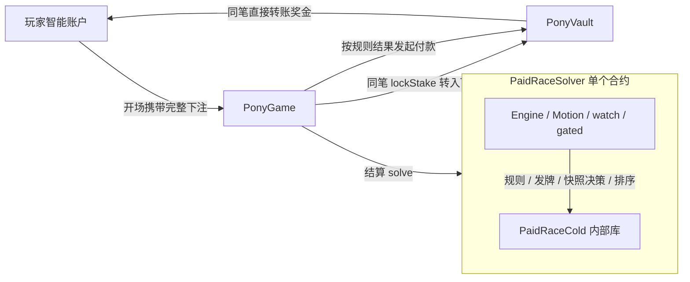

# 链上架构与经济

## 1. 权威边界

Monad 上的 `PonyGame` 以固定规则版本、入场 seed、角色名单、实际选牌交易的时间与区块哈希，独立复算五马冲线名次；`PonyVault` 只执行 `PonyGame` 的账务指令。浏览器运行同一套 TS 规则用于即时画面与预览，不是付款裁判；Envio 只提供可回滚的历史与统计。比赛规则见[玩法设计](game-design.md)与[卡牌设计](card-design.md)，求时器与表现层见[效果系统](effect-system.md)，部署配置见[部署与服务](deploy.md)。

每场有奖比赛在开场与结算时写链，每次选牌或主动放弃另发一笔小额交易。

```text
Mera 通行密钥 → 根 EOA → Alchemy sma-b → Monad / PonyGame
       │              │                         ├─ PaidRaceSolver（内部 Engine/Motion/Cold）
       │              │                         ├─ PonyRewards（持久获得账本）
       │              └─ owner / recovery       └─ PonyVault → 玩家 sma-b（原生 MON）
       └─ 独立 PRF 命名空间 → 图鉴密钥

浏览器：规则预览、交易发起与状态恢复
Envio：合约事件的可回滚历史与统计
图鉴 Worker/D1：仅同步浏览器加密后的图鉴密文
```

## 2. 账户、资产与授权

根 EOA 由 Mera 通行密钥的 WebAuthn PRF 经 BIP-39/BIP-32 派生，保持既有派生路径及地址。由该 EOA 拥有并恢复独立的 Alchemy Modular Account V2（`sma-b`），显式 `createAdditional: true`，按链 ID 与根地址缓存账户地址、登录时重新解析核对；资金与交易发送方都是这个智能账户，不把根 EOA 当作默认同址 EIP-7702 账户（[Alchemy 账户类型](https://www.alchemy.com/docs/wallets/transactions/using-eip-7702)、[Monad EIP-7702 规则](https://docs.monad.xyz/developer-essentials/eip-7702)）。WebAuthn `rpId` 取当前 `location.hostname`，换域名会派生不同账户。

通行密钥与派生材料不落盘，刷新页面后需重新登录。注册只向智能账户请求一次水龙头，受理与链上余额实际增加分别报告；余额始终读 RPC。

项目只使用 Monad 原生 MON，不部署或依赖 ERC-20/WMON，金额以 wei 记账。玩家钱包余额与 Vault 偿付余额均读取原生币余额。图鉴密钥由独立 PRF salt 派生，不签交易。临时 Action Key 不作为结果权威。

合约侧已实现 Agent 下注额度：玩家通过 `configureAgentBudget(expiry, maxStake)` / `revokeAgentBudget()` 设定期限与累计下注上限（`contracts/abstracts/AgentBudget.sol`），授权的 Session Key 只能调用 `openAgentSession` 开场；`chooseCard` 仍要求调用者是玩家本人。前端只有测试使用的授权辅助函数 `grantAgentSession`（`src/chain/alchemy.ts`），产品流程、`paidCalls` ABI 与 Envio 均未接入。

//TODO - 接入 Agent 开场：在 `src/chain/paidCalls.ts` 加入 `configureAgentBudget`、`revokeAgentBudget`、`openAgentSession` 的 ABI 与调用，钱包面板提供额度设置与撤销；`tests/api/ts` 在 anvil 上断言超期、超额与撤销后开场均回退，且 Session Key 无法 `chooseCard`、转账或修改 owner。

## 3. 合约与资金

部署四个具体合约：`PonyGame`、`PonyVault`、`PaidRaceSolver`、`PonyRewards`。

- **PonyGame** 保存会话与选择事实、封存随机锚、接收下注、调用求时器并发起结算。求时器与 `rulesetHash` 在构造时固定，各名次赔率是不可变常量；Vault 由 owner 调用一次 `bindVault` 绑定，之后不可更换。每个账户同时只有一场未完结会话（`sessionOf`，重复开场回退 `ActiveSession`）。
- **PonyVault** 固定资产与唯一 Game，只接受 Game 登记下注与发起奖金结算。
- **PaidRaceSolver** 内联热核心与冷路径内部库，独立完成无状态事件求时，不创建辅助计算合约。
- **PonyRewards** 是跨 Game 版本复用的获得账本，由 owner 用 `setGame` 登记可写入的 Game；它不求时、不持有下注，也不决定返奖。

Game 与 Vault 各有一个入场暂停开关，Game 部署后默认暂停。管理员可暂停新入场、管理庄家流动性，但不得修改已开场规则、占用已锁定下注或赔付预留；owner 不可放弃（`renounceOwnership` 回退），因为求时器故障判负只能由 owner 发起。换规则即部署新的求时器、`PonyGame` 与 `PonyVault`；已有会话由旧 Game 按其求时器结算或判负，但客户端与 Keeper 只跟踪当前配置的 Game（§8）。**Vault 不设退款，也不提供玩家充值、可用余额或提款入口。**

### 3.1 资金不变量

定义 `L` 为未结算下注总和、`H` 为庄家自有流动性、`R` 为最大庄家净赔付预留总和：

```text
address(Vault).balance >= L + H
H >= R
R(session) = max(maxPayout - stake, 0)
```

1. **开场**：玩家智能账户调用 `PonyGame.openSession{value: stake}(horseId, stake, roster)` 一次支付完整下注；余额不足时客户端在发送前拦截，不向 Vault 充值。Game 校验 `msg.value == stake`，同笔调用 `Vault.lockStake{value: stake}` 登记下注与本场预留；本场预留超过 `H − R` 时整笔回退，前端提示 `house-liquidity`。
2. **结算**：Game 按求时器给出的 `settlementOrder` 计算返还，调用 `settleStake(sessionId, payout)`；Vault 要求 `payout` 不超过锁定的最大赔付，释放预留后尝试向玩家智能账户转账。玩家接收调用失败时，该笔返还计回庄家流动性，以实际返还 0 完成结算，不保留补领入口；`StakeSettled` 与 `SessionSettled` 记录实际返还。
3. **判负**：`forfeitSession` 按返还 0 处理，下注转入庄家流动性并释放预留。必要随机锚尚未封存且超过 8191 块读取窗口时任何人可调用；锚齐全但求时器预览失败时，仅 owner 可在开场满 1 天后调用，并先以 `FORFEIT_PROBE_GAS` 预算探测预览确实失败。判负与结算互斥；玩家放弃某个检查点的选牌不判负。
4. **庄家资金**：`fundHouse` 与 `withdrawHouse` 仅 owner 可调用，只能提取 `H − R`。

转账前先扣账并防重入；Envio 或管理员不能调用 Game 专用记账入口。

### 3.2 档位与赔率

| 下注档位 | 0（免费本地试玩） | 0.3 MON | 1 MON | 5 MON | 10 MON |
| --- | --- | --- | --- | --- | --- |
| 最大庄家净预留 | 0 | 0.6 MON | 2 MON | 10 MON | 20 MON |

名次 1–5 的总返还倍率为 `[3, 1.5, 1, 0, 0]`（含本金）。0 档不建立链上会话，不领取链上奖金。下注档位只决定下注额，不改变电脑马参数或牌堆规则。

当前上线范围仅为 Monad 测试网。代码不保证任意策略的长期返还率低于 1；返还统计须由[玩法设计 §5.4](game-design.md) 的脚本按明确输入复算，有限样本与近似策略不构成全部策略的收益上界。

### 3.3 合约文件与调用边界

| 文件 | 类型 | 职责 |
| --- | --- | --- |
| `contracts/PonyGame.sol` | 部署合约 | 会话与选择事实、随机锚封存、下注转入、求时器调用与结算发起 |
| `contracts/PonyRewards.sol` | 部署合约 | 玩家获得位图与 session 去重记录，授权已登记 Game 写入 |
| `contracts/PonyVault.sol` | 部署合约 | Game 专用下注托管、庄家流动性与赔付预留、直接奖金付款 |
| `contracts/PaidRaceSolver.sol` | 部署合约 | 求时器入口，派生输入并执行事件引擎，返回完整规则结果 |
| `contracts/interfaces/IPaidRaceSolver.sol` | 接口 | Game 与求时器的输入、结果和规则标识 |
| `contracts/abstracts/AgentBudget.sol` | 继承模块 | Game 中的 Agent 累计下注额度与期限 |
| `contracts/libraries/PaidSeed.sol`、`RandomAnchor.sol`、`RacePayout.sol` | 内部库 | 会话 seed、区块哈希读取、赔付计算，编入 Game |
| `contracts/libraries/PaidRaceEngine.sol` | 内部库 | 唯一拥有比赛内存状态、时间映射、事件顺序、效果生命周期、监听触发与门控修正 |
| `contracts/libraries/PaidRaceMotion.sol` | 内部库 | 直接读写 Engine 的 Horse/Bomb/Stretch 内存，执行阈值扫描、解析推进与 RK2 |
| `contracts/libraries/PaidRaceCold.sol` | 内部库 | 属性与牌堆派生、规则表、发牌合法性与转移、卡牌快照决策与排序 |
| `contracts/libraries/PaidRaceCardPlan.sol`、`PaidCardRules.sol` | 内部库 | 快照动作决策与生成的卡牌参数；动作由 Engine 应用 |
| `contracts/libraries/PaidProfiles.sol`、`PaidDeck.sol`、`PaidCpuDeck.sol` | 内部库 | 五马属性、玩家牌堆和 CPU 牌堆派生 |
| `contracts/libraries/PaidDrawRules.sol`、`PaidSettlement.sol` | 内部库 | 发牌合法性与状态转移、物理排序与结算排序 |
| `contracts/libraries/PlayerBalance.sol`、`PonyRules.sol`、`RewardRules.sol` | 内部库 | 由 TS 规范表生成的玩家基线与 CPU 上限偏移、角色能力与启用目录、获得抽取参数 |
| `contracts/libraries/PaidSwap.sol`、`RaceEntropy.sol` | 内部库 | 交换快照决策与用途域分离的确定性派生 |

内部库与继承模块不对应独立部署地址。Engine 唯一持有比赛状态；Motion、watch/gated 与 `PaidRaceCold` 都在 Solver 的同一内存帧内执行，Cold 只提供纯函数，不拥有另一套比赛状态。Solver 不链接外部计算合约，不使用 DELEGATECALL 或组件注册表；生产结算与诊断入口共用同一 Engine/Motion 内核。



## 4. 规则输入、时钟与随机锚

免费试玩与有奖比赛共用同一个 TS 求时器 `solvePaidCore`，Solidity 复算同一规则。规则输入只有：seed、入场锚、玩家槽位、五名角色名单与实际选择（含时间与锚）；下注档位只决定下注额，经校验后不进入求时，gogo 与镜头也不进入。试玩以本地 seed 与本地锚代替链上输入、按同法派生，不调用钱包或 Vault；显式 `?seed=` 同时播种选马队列，使名单与规则输入可复现。有奖输入只来自下列链上事实。

单场固定五名参赛者。`ponyId` 是目录身份，`raceHorseId` 是单场索引，`roster[raceHorseId]` 给出角色；开赛后名单固定，换道只改变 `laneIndex`。Game 拒绝目录外或重复角色，不校验解锁。能力、卡牌主功能和启用目录纳入当前 v0.1 规则哈希，参数由 TS 规范表生成 Solidity。

`openSession(horseId, stake, roster)` 锁定 `sessionId`、玩家智能账户、玩家参赛索引、`roster[5]`、下注档位、seed、入场交易区块 `b_0` 与 `block.timestamp = T0`；规则版本由该 Game 不可变的 `rulesetHash` 决定，不随会话存储。seed 由合约以域标签 `ponygogogo/session-seed/v1` 和 `(chainId, Game, 玩家, 单调 nonce)` 确定性导出（`PaidSeed`），不接受玩家传入。入场块哈希在后续块读取并封存，由 `H(seed, blockhash(b_0), 0, purpose, eventIndex)` 派生：玩家 14 张牌堆（2 张取自 rare 子集，12 张取自其余卡）、每匹电脑马 3 张私有牌（只取 CPU 可用子集）、四匹电脑马的速度上限偏移。

`chooseCard(sessionId, checkpoint, cardId, refreshSlots)` 记录实际交易的入块秒 `Ti = block.timestamp − T0`、区块号 `b_i` 和输入，`cardId = 0` 表示主动放弃。合约对每个检查点只记录第一笔交易，只做形状检查：调用者为玩家本人、检查点 1..3 严格递增、`cardId ≤ 40`、刷新数 ≤ 3、刷新位置 ≤ 2。`Ti` 是否落在选择窗口、候选与刷新额度是否合法由结算求时判定；违规选择按无交易处理并记 `CHOICE_INVALID`，且不能重发。

**选择窗口。** 玩家里程首次达到检查点的规则时刻为 `openMs`，窗口为 `openSec = ceil(openMs / 1000)` 至 `openSec + 20`（末端不含）。浏览器在 `openMs` 展示候选，到 `openSec` 才允许提交；规范效果时刻为 `Ti × 1000 ms`，超时在 `(openSec + 20) × 1000 ms` 生效。这最多增加不足 1 秒的面板等待，换来秒级时间戳不会把检查点前的交易误认成有效选择。

**随机锚。** 每个实际选择块哈希在后续区块验证并封存：`chooseCard`、`settleSession` 与公开的 `sealAnchors` 都会封存当时可读的锚。锚先直读 `BLOCKHASH` 的 256 块，之后读 [EIP-2935](https://eips.ethereum.org/EIPS/eip-2935) 历史合约至 8191 块（`RandomAnchor`）；窗口以块数判定，界面按实测块时间估算剩余分钟（`src/chain/settleDeadline.ts`）。超窗仍未封存即视为丢失，任何人可 `forfeitSession`。玩家选牌效果始终使用获得该卡的 `b_i`，C-09 的全部自动交换只推进触发序号；CPU 私有卡使用入场锚；自动选牌继承已锁定的上一阶段锚；主动放弃、超时和断卡不生成新随机锚。

**权威时间使用链上秒级时间，不用区块高度换算比赛时钟。** 正常阶段模拟时间以 `dτ/dt = 1` 推进，选牌慢放阶段为 `0.1`；合约从 `T0`、各 `Ti`、由赛马状态推导的检查点开启时刻与 20 秒截止建立分段时间映射，直接求冲线用时。浏览器侧 `usePaidRace` 以 1.5 秒周期用 `ChainClock` 校准链头，画面按 `performance.now()` 连续采样规范轨迹，只负责流畅画面与待确认预览；交易确认后按规范输入重新求时。页面停止运行时链上规范时间仍前进，恢复后从已锁定交易时间重新求时，不得提交本地声称的暂停时长或完成 tick。选择交易只能证明秒级规范动作时间，不能证明鼠标点击的毫秒瞬间；链重组时按 canonical 区块时间与哈希重新求时（[Solidity `block.timestamp` 单位](https://docs.soliditylang.org/en/latest/units-and-global-variables.html)）。

**区块哈希是可复核的随机输入，不自动保证绝对无偏。** 正式资金场次还须检验交易排序、选择性不提交与可重试开场的偏差；风险不可接受时改用独立 VRF 或承诺揭示，而不是声称 blockhash 单独解决公平性。

## 5. 链上求时与结算

`PonyGame.settleSession(sessionId)` 不接收名次、完成时间或浏览器终态。合约从本场已锁定的 seed、入场哈希、名单、选马与档位、每次实际选择的 `Ti/b_i/cardId/refreshSlots` 及已核验区块哈希，调用 Solver **直接求出五匹马首次跨过终点的 `finishTime[0..4]`**。事件表、解析积分、重力井 RK2 与同刻顺序见[效果系统 §5](effect-system.md)，链上不按浏览器帧或逐 tick 回放比赛。

- 以 `(finishTime, horseId)` 升序得到物理排序 `rawOrder`（玩家名次 `playerRawRank`）。
- 从规范获得的卡牌集合检查【版本答案】；触发时把玩家置于 `settlementOrder` 第一，其余马保持物理相对顺序（玩家名次 `playerSettlementRank`），否则两者相同。Game 按 `settlementOrder` 计算返还；特殊分支是合约规则，不是客户端可写的 `forcedRank`。
- 结算交易须满足 `(block.timestamp − T0) × 1000 ≥ finishWall[玩家]`（`finishWall` 含选牌慢放映射）。
- 第三个实际检查点处理完毕且所需哈希可读后，输入已齐，任何人都能提前调用同一求时器预计算；前端仍等玩家冲线才展示结果。未到第三检查点就冲线的场次只纳入已发生事件。
- 结算开头与抽取获得物前都要求剩余 gas ≥ 200k；读取 `ownedMask` 限 20k、`record` 限 120k。获得物在 Vault 付款前记录，玩家合约无法在收款时耗尽 gas 使有效结算失败。

浏览器在回执后用同一 TS 求时器复算，`compareSettlement`（`src/race/paidResult.ts`）比对名次、`rawOrder`、`settlementOrder`、`finishTime` 与获得卡牌；界面只在名次不一致时提示，不上链，也不进入赔率或付款公式。

规则冻结的上限为 `MAX_TAU = 600000` ms、`MAX_EVENTS = 4096`、`MAX_INSTANCES = 96`、`MAX_BOMBS = 20`，事件、实例或炸弹超限抛错；达到模拟时间上限的未冲线马记 `finishTime = 600001` 并照常排序。全部运算为整数，冲线时间取满足 `pos ≥ L` 的最小整数毫秒，同毫秒按 `horseId`。体积、gas 样本与测试入口见 §9；它们不构成连续解误差或所有合法场次 gas 上界的证明。若最坏场次超出 Monad 单笔 gas 限制，有奖版不能退回浏览器名次或逐 tick 合约循环（[Monad gas 规则](https://docs.monad.xyz/developer-essentials/gas-pricing)）。

## 6. 事件与获得物

`PonyGame` 发出 `SessionOpened`（sessionId、玩家、马、下注、seed、`openedAt`、`openedBlock`、`rulesetHash`、`roster[5]`）、`CardChosen`（检查点、`cardId`、刷新位置、`txSec`、区块号）、`RandomAnchorSealed`（源区块与实际哈希）、`SessionSettled`（`finishTime[5]`、`rawOrder`、`settlementOrder`、玩家结算名次、返还、`digest`、实际获得的三张牌）、`SessionForfeited`（含判负原因）；Vault 发出 `StakeLocked`、`StakeSettled`（判负为返还 0）与庄家资金事件。

有奖结算完成求时、名次校验与状态更新后，或判负完成资格校验与状态更新后，均以当前终局交易父区块哈希独立抽取获得物：概率 20%，未拥有的稀有卡权重 1、非默认角色（ponyId 5–8）权重 3；仅试玩不抽取新的角色和卡牌。`PonyRewards` 发出 `CollectibleGranted` 并更新位图；读取或记录失败时 Game 发出 `CollectibleSkipped`，不阻断返奖。获得物不参与求时、名次或返奖。浏览器以结算回执中是否有 `CollectibleGranted` 判断获得；`CollectibleSkipped` 只在链上留痕，浏览器与 Envio 都不使用。

## 7. 索引、图鉴与战绩

**Envio 读模型。** Envio（`envio/`）按合约事件建立比赛历史、玩家战绩、角色胜率与 Vault 统计，角色统计按 `roster` 映射；通过 `RewardsBound`、`VaultBound` 动态注册账本与 Vault，并启用重组回滚。它不索引 `CollectibleSkipped`、`AgentBudget*` 与 Vault 的暂停事件。浏览器从 `VITE_ENVIO_GRAPHQL_URL`（生产构建必填，开发模式缺省时钱包不显示战绩）查询当前账户最近会话；响应缺少有效名单或格式不合法时整个结果失败，不以部分记录掩盖问题。RPC/合约决定资金与会话状态，链重组后 Envio 按 canonical 事件重算统计。

**收藏的三个来源。** 默认开放角色、链上 `PonyRewards` 位图与已解密的图鉴收藏求并集，供图鉴与选马使用（`src/ui/collection/useCollectionProgress.ts`）。普通卡默认开放；首页卡牌数按普通卡与已拥有稀有卡的并集计数，未读取时显示 `— / 40`。配置 Game 后，「读取收藏」只刷新链上位图，无需通行密钥验证或加密备份服务；奖励回执触发的加密备份与重试仍使用下述协议。解锁只影响客户端选马与图鉴，不筛选合约入场或牌池；图鉴密文不构成链上所有权证明。

**图鉴同步协议（v0.1）。**

- 密钥：通行密钥以钱包之外的两个 PRF 用途域分别派生 AES-256-GCM 加密密钥与 Ed25519 同步身份（`src/chain/collectionIdentity.ts`）；明文与解密材料只在浏览器内存。
- 明文：`schemaVersion: "0.1"`，保存 `rareCardIds` 与 `unlockedPonyIds`；密文 envelope、AES 附加认证、同步签名与两个 PRF 用途域统一为 v0.1，不读取旧测试格式。
- 接口：`POST /api/collection/challenge` 创建一次性挑战，`POST /api/collection/read` 验签读取，`PUT /api/collection` 验签条件写；入口 `scripts/Wrangler/worker/collection.ts`。
- 签名：覆盖域标签 `ponygogogo/collection/v0.1`、公钥、挑战 ID 与挑战值、来源、方法、路由与载荷。挑战 120 秒过期；每个 IP 哈希每分钟最多 30 次挑战，每个身份最多 10 个未消费挑战；请求体不超过 8 KB，跨源请求返回 403。
- 存储：D1 每行保存 `user_id`（公钥的 SHA-256）、公钥、并发计数 `version`、IV、密文与更新时间，另有挑战、限流计数与 Keeper 状态表。
- 并发：写入携带 `expectedVersion`，冲突返回 409，客户端解密最新数据求并集后重试（最多 3 次）。失败保留本地进度，退出登录作废旧请求；解密失败、未知格式与网络错误不得把未确认奖励报告为已获得。

## 8. 交易状态与会话恢复

有奖会话的生命周期是：开场锁定下注与庄家预留 → 每次选牌写链 → 冲线后合约求出 `rawOrder` 与 `settlementOrder` → Game 指示 Vault 付款。界面以 `SessionSettled` 中的实际返还展示金额，不按预览倍率声称到账。

各流程的界面状态如下，预览奖金不标记为已到账：

| 流程 | 状态 | 来源 |
| --- | --- | --- |
| 开场 | 签名中、已提交、已入块、失败、未确认（超时仍查不到终态） | `src/chain/sessionProtocol.ts` |
| 选牌 | 排队、发送中、已提交、已入块并生效、已入块但按规则忽略、被拒、未知 | `src/race/paidDriver.ts` |
| 结算 | 等待、已提交、已结算、失败、已判负；结算未确认显示为失败并附说明 | `src/result/types.ts`、`src/ui/race/usePaidRace.ts` |

登录后 `usePaidRace` 按「账户 → `sessionOf` → `getSession`」恢复当前配置 Game 的未完结会话；已结算会话再从开场块扫描 `SessionSettled`。调用 ID 只在当前页面用于轮询，交易哈希与调用 ID 都不持久保存。刷新不抹掉已确认选择；结算失败保留原会话及可复核输入，不创建新场覆盖旧记录。全部必要锚封存后没有结算截止时间。

客户端没有历史 Game 地址列表：换部署后，旧 Game 上的未完结会话在链上仍可结算或判负，但界面不提示恢复，Keeper 也只跟踪 `KEEPER_GAME_ADDRESS`。

**冲线后无人结算会被判负。** 浏览器正常流程不单独发送 `sealAnchors`，最后一次选牌所在块（未选牌时为开场块）的锚只在结算交易中封存。玩家冲线后若约 8191 块内没有任何人结算，该锚过窗丢失，Keeper 会把会话判负，即使物理名次第一。

## 9. 验收门禁

- `bun run check:contracts` 构建并断言所有部署合约 runtime ≤ 131,072 B、initcode ≤ 262,144 B，且创建码与运行码均无库链接；EIP-170 余量只作报告。
- `bun run check:solver-monad` 用只读 `eth_call` state override 验证 80 场生产输入的结果哈希与 Monad gas，另测一条诊断内核的对抗输入，不签名或广播；求时 gas 加 300k 包装余量须不超过 23.5M 回归预算（Foundry 向量测试的 `SOLVE_GAS_CAP` 相同）。Foundry gas 按以太坊计价，只作本地回归对照。
- `check:paid-cards`、`check:paid-vectors`、`check:pony-rules`、`check:reward-rules`、`check:pony-vectors` 校验生成物与 TS 规范表一致；`forge test` 覆盖跨语言向量、Vault 不变量、名单与奖励。

修改已部署规则时，须重新生成规则表与向量、通过上述门禁，并部署新的求时器、`PonyGame` 与 `PonyVault`。有奖结算不得依赖浏览器自报名次、退款入口、Game Server 或逐 tick 链上回放。

//TODO - 牌库与数值定稿后，结合三张选择、CPU 可用集合、装备转移、翻新与冲线截断，收紧重力井有效期与积分切段的可达上界，构造最坏合法输入并测量含派生与包装的生产 `PaidRaceSolver.solve`，证明不超过 23.5M；超出时先降低求时成本，不放宽预算。23.5M 是基础设施预算，现有样本不是最坏输入的证明。
